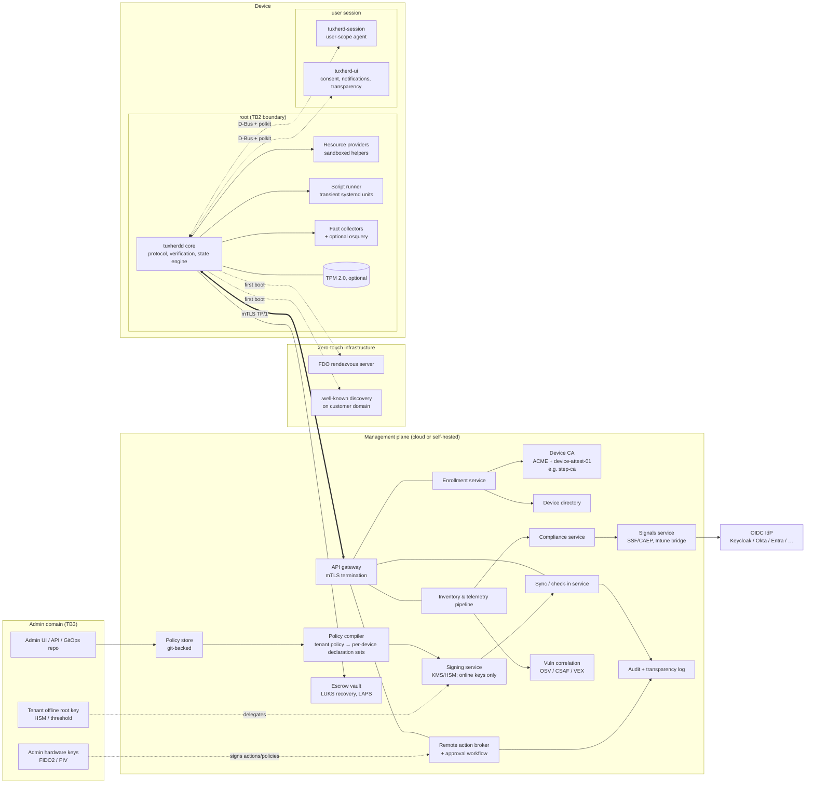
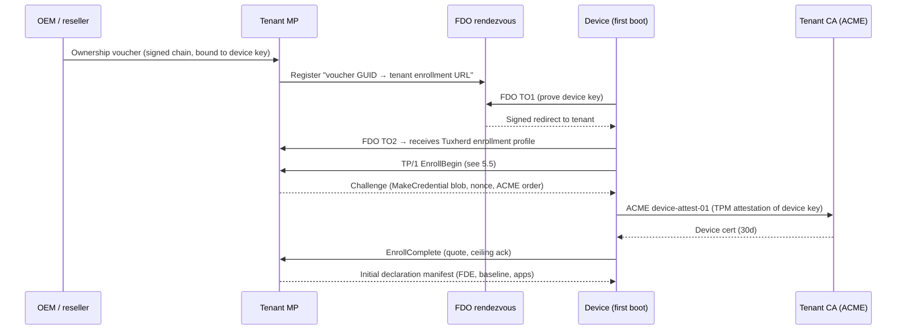

# Tuxherd: An Open Endpoint Management Protocol and Distro Conformance Profile for Linux

**Status:** Architecture proposal, draft 0.1 · **Date:** 2026-10-26 · **Audience:** distro maintainers, management-plane vendors, enterprise IT architects, prospective foundation members

---

## 1. Executive summary

**Tuxherd** is an open protocol plus a distro conformance profile. Together they make any Linux install managed from day one, the way Windows is under Intune or macOS is under Apple's MDM and Declarative Device Management. It has three deliverables:

1. **Tuxherd Protocol (TP/1):** a wire protocol between a device agent and a management plane. It covers device identity and enrollment, declarative configuration and compliance, inventory and status, and signed remote actions.
2. **Tuxherd Ready Profile (TRP):** a versioned, testable spec that says what a distro ships so that its installs speak TP/1 without extra work. That means an agent in the official repos, installer enrollment hooks, FDE with recovery escrow (TPM-bound unlock where hardware allows), drop-in configuration paths, advisory feeds, and immutable-image support.
3. **Reference implementations:** a small, Apache-2.0-licensed agent (`tuxherdd`, written in Rust) and a minimal reference server. These prove the spec and give distros something to package. They are not meant to beat commercial management planes.

**Why now.**
- Intune on Linux has been stuck at two distros and a narrow feature set: no inventory, lock, wipe or app deployment.
- Himmelblau shows strong demand for Entra-joined non-Ubuntu/RHEL machines, but it is bound to Intune's model, including policy applying only to the first signed-in user.
- Windows 11's hardware requirements made TPM 2.0 nearly universal on business PCs.
- systemd now ships the primitives Linux was missing: `systemd-cryptenroll`, UKIs, `systemd-pcrlock`/`systemd-measure`, `systemd-homed`, sysext/confext. fwupd reports firmware security levels (HSI) and drives BIOS settings.
- Regulation (NIS2, DORA, the Cyber Resilience Act) and European public-sector moves to Linux mean auditors want compliance evidence for every endpoint, not just Windows.

Every Linux management tool today has its own enrollment, agent and control channel, so every one must also do its own per-distro integration. A shared protocol turns that N×M problem into N+M.

**What Tuxherd is NOT:**
- **Not a Fleet, Rudder, Landscape or Uyuni clone, and not a competitor.** It is the layer underneath them. The goal is that Fleet, Rudder, Uyuni, Landscape and eventually Intune implement TP/1 on the server side and stop maintaining bespoke Linux agents.
- **Not a new config-management language.** It has no Turing-complete DSL. Configuration is typed declarations; conditions use CEL.
- **Not a new instrumentation engine.** It uses osquery, OpenSCAP, systemd, fwupd, PackageKit and the native package managers.
- **Not a server-fleet tool.** Workstations and laptops come first. Servers can enroll, but Ansible, Salt and Puppet already cover them.
- **Not a surveillance product.** BYOD privacy limits are enforced by the agent on the device, not just promised by the server.

---

## 2. Design principles

1. **Protocol first, products second.** The value is in interoperability. Any conformant agent must work with any conformant server. Reference code exists to validate the spec, not to own the market.
2. **Distro-neutral by abstraction, distro-specific by plugin.** The protocol speaks in *intents*, for example "SSH password auth disabled" or "AppStream app `org.mozilla.firefox` present". Distros or plugins map intents to `apt`, `dnf`, `zypper`, `rpm-ostree`, `bootc`, `transactional-update`, flatpak, snap or Nix.
3. **Compose, don't reinvent.**

   | Need | Existing project used |
   |---|---|
   | Instrumentation | osquery (optional extension), native fact collectors |
   | Compliance content | OpenSCAP / SCAP Security Guide, CIS |
   | Encryption | LUKS2, `systemd-cryptenroll` |
   | Boot integrity | UKI, `systemd-measure`, `systemd-pcrlock`, Keylime-style verification |
   | Device certificates | ACME; optional `device-attest-01` (step-ca already implements it) |
   | Zero-touch | FIDO Device Onboard (FDO), already packaged in RHEL for Edge |
   | Firmware | fwupd/LVFS, kernel `firmware-attributes` |
   | Software | PackageKit, AppStream IDs, Flatpak |
   | Users | `systemd-homed`, SSSD, Himmelblau |
   | Signing | TUF-style metadata, JWS, Sigstore-style transparency log |
   | Signals to IdPs | OpenID Shared Signals Framework (SSF/CAEP) |

4. **Security first, least privilege.** The device verifies everything it is told to do against keys the server alone does not control (see §10). The root agent is small, and work is done by sandboxed helpers.
5. **The device enforces its own limits.** Each enrollment has a *capability ceiling* agreed at enrollment and stored on the device. No server compromise can exceed it.
6. **BYOD-respecting.** Personal devices get scoped management, with a published list of what may never be collected. The user can see every query and action locally.
7. **Offline-tolerant.** Laptops are offline a lot. Policy is evaluated locally, results queue, and lease-based fallbacks need no connectivity.
8. **Immutable tenant-shipped OCI workspaces; immutable hosts first-class.** Tenant-shipped OCI workspace apps ship as signed, digest-pinned images with ephemeral writable app state and encrypted persistent data; the §7.2 and §9.2 delivery models keep their own persistence rules. Image-based hosts (Fedora Atomic/bootc, openSUSE Aeon/MicroOS, Ubuntu Core, NixOS) remain first-class targets; workspace immutability does not imply host integrity. OCI workspaces are an app delivery option alongside §7.2.
9. **Honest compliance.** A compliance report is a claim by the device. The protocol records *how much* it is attested (software key, TPM key, measured boot), so relying parties can choose the trust level they need.

### 2.1 Authority tiers

| Tier | Ownership / tenant authority |
|---|---|
| **T0: Unenrolled Workspace** | No device enrollment; manage only the registered workspace's apps, identity, encrypted data and scoped actions. No tenant host agent or host inventory. |
| **T1: Enrolled BYOD** | `ownership: byod`; allowlisted read-only device posture and workspace-only actions (§8.5). Includes posture-only BYOD without a work user. |
| **T2: Corporate** | `ownership: corporate`; device management within the agreed capability ceiling. |

These are authority levels, independent of capability and evidence (§5.1). They are unrelated to §6.4's IdP integration paths A/B/C. T0 registration is not TP/1 device enrollment; see the [proposed MAM supplement](docs/workspace-capability-mam.md) for its protocol and privacy limits.

## 3. Gap analysis

Legend for "What closes the gap":
- **P** = needs the protocol (interop spec)
- **D** = needs distro conformance (something the distro must ship or support)
- **I** = implementation work only (the plumbing exists)

| Capability | Intune on Windows | Intune on Linux (2026-10) | Tuxherd design | What closes the gap |
|---|---|---|---|---|
| Device registration / identity | Entra join, TPM-backed | Entra registration (Ubuntu 24.04/26.04 GNOME, RHEL 9/10) | ACME device cert, TPM-bound where present (software key otherwise), any TRP distro | **P + D** |
| Zero-touch provisioning | Autopilot (OEM hardware hash) | None | FDO ownership vouchers, account-driven enrollment (`.well-known`), installer profiles | **P + D** (+ OEM participation) |
| Compliance policies | Rich | Distro/version, encryption, password complexity, custom scripts | Typed facts + CEL rules + OpenSCAP profiles, device and user scope | **P** (schema), **I** |
| Conditional Access | Native | M365 web apps in Edge only | SSF/CAEP to any OIDC IdP, mTLS device certs, Intune custom-compliance bridge | **P** (signal profile), **I** |
| Settings catalog / config profiles | Thousands of CSPs | None (scripts only) | Typed resource catalog (SSH, sudo, polkit, dconf/KConfig, firewall, browsers, NM, …) | **P** (catalog), **D** (drop-in dirs) |
| App deployment | Win32/MSIX/Store | None | AppStream-ID + native package + Flatpak declarations, repos, rings | **P + D** |
| App inventory | Discovered Apps | None | Package DBs + AppStream + Flatpak/snap enumeration | **P** (schema), **I** |
| Hardware inventory | Yes | None | DMI/udev/fwupd/TPM facts | **P** (schema), **I** |
| OS update rings | WUfB rings, deferrals | None | Ring declarations. Image digests on immutable systems; snapshot/mirror pins on package-based systems | **P**, **D** (snapshot repos) |
| Firmware updates | Driver/firmware via WU | None | fwupd/LVFS policy + HSI compliance | **I** (exists), **P** (schema) |
| Disk encryption + key escrow | BitLocker + escrow | Compliance check only | LUKS2 + TPM2/FIDO2/passphrase unlock + escrow + rotation | **D** (installer), **P** (escrow) |
| Remote lock | Yes | None | Session / account / device lock (keyslot removal) + offline lease | **P**, **I** |
| Remote wipe / Fresh Start | Yes | None | Tiered wipe: workspace / userdata / crypto-erase / sanitize + re-provision | **P + D** (recovery UKI) |
| Retire / selective wipe | Yes | None | Managed-state rollback, workspace removal | **P** |
| Scripts | PowerShell | Bash (15-min default) | Signed scripts in transient systemd units with sandbox profiles | **P** (signing), **I** |
| Remediations | Proactive remediations | None | Detect/remediate pairs, CEL-gated | **P** |
| Security baselines | Yes | None | SSG/CIS profiles as declarations, audit or enforce | **I** (SSG exists) |
| LAPS | Windows LAPS | None | Local admin credential rotation + escrow | **P**, **I** |
| Certificate / Wi-Fi / VPN profiles | SCEP/PKCS, profiles | None | ACME/SCEP user certs, NM keyfiles, trust-store abstraction | **P**, **D** (trust store paths) |
| Per-user policy on multi-user systems | Yes | First user only (Himmelblau limitation) | Device scope + user scope via logind/PAM session agent | **P + D** (hard; see §6.5) |
| BYOD / MAM separation | Work profile / MAM | Not offered (all corporate) | Work user (homed) + capability ceiling + privacy allowlist | **P + D** |
| Device health attestation | DHA / MAA | None | TPM quote + event log + distro reference measurements (optional; requires TPM) | **D** (hard), **P** |
| RBAC / audit | Yes | Yes (server side) | Server side + device-verified admin signatures + transparency log | **P** (signatures), **I** |

**Takeaway.** About a third of the gaps are pure implementation that Fleet, Rudder and others have partly solved. The parts no single vendor can fix are enrollment, attestation, the config intent catalog, wipe semantics, per-user scope and BYOD separation. Each needs either a shared protocol or distro cooperation, and that is Tuxherd's scope.

---

## 4. Architecture

### 4.1 Component overview



### 4.2 Management plane components

| Component | Responsibility | Proven technology / new |
|---|---|---|
| API gateway | mTLS termination, device-cert validation, rate limiting, tenant routing | Envoy / nginx; standard |
| Enrollment service | Authenticates the bootstrap credential (token, OIDC, FDO voucher), drives attestation, binds device to tenant | **[NEW]** logic on proven primitives |
| Device CA | Issues short-lived device certs via ACME with optional `device-attest-01`; bootstrap-authorized software-key proof otherwise (§5.5) | step-ca (already supports TPM device attestation) |
| Device directory | Device records, ownership mode, groups, lifecycle state, capability ceiling | Postgres |
| Workspace registry | T0/T1/T2 workspace instances, registered user/tenant keys and workspace-only ceilings; separate from device enrollment | **[NEW]**, proposed MAM supplement |
| Workspace key broker / verifier | Bounded instance-volume leases; policy/evidence evaluation; independent instance KEKs wrapped by tenant KMS keys | **[NEW]**, KMS/HSM + signed reference-policy verification |
| Remote workspace gateway / renderer (proposed) | Tenant-side apps, credentials and data; authorized render sessions, server-enforced channel policy, watermarking and termination | Optional delivery adapter; no prescribed VDI vendor; §9.3 |
| Evidence broker interface | Consented, fixed-verdict host evidence via owner-controlled TRP-Attested broker (A-BRK-01); no arbitrary tenant queries or raw event-log transmission | **[NEW]**, local broker + remote verifier |
| Policy store | Source of truth for policy; GitOps-friendly YAML; versioned | git + Postgres (Fleet-style GitOps) |
| Policy compiler | Resolves targeting, rings and conflicts into a per-device *declaration set*; content-addressed | **[NEW]** |
| Signing service | Signs declaration manifests with *online* delegated keys. High-risk payloads need admin signatures (§10) | KMS/HSM + TUF-style delegation |
| Sync service | Check-in handling, manifest diffing, push wake-ups over the persistent stream | **[NEW]**, modelled on Apple DDM sync |
| Remote action broker | Queues signed commands, multi-party approval, delivery receipts | **[NEW]** |
| Inventory / telemetry | Ingests status items; historical store | Postgres + columnar store (ClickHouse etc.) |
| Compliance service | Server-side re-evaluation, grace periods, state transitions | **[NEW]**, small |
| Vuln correlation | Matches package inventory to distro advisories | OSV, CSAF/VEX, OVAL feeds |
| Signals service | Sends compliance changes to IdPs; Intune bridge | OpenID SSF/CAEP transmitter |
| Audit + transparency log | Append-only log of every policy version and action; Merkle proofs | Trillian/Rekor-style |
| Evidence log | Second transparency log (`corp-evidence`) on the payload log's infrastructure; salted evidence commitments with separate retention/privacy rules. Devices never need inclusion proofs for it | Same log infrastructure; `AuditEvidence` in the MAM supplement |
| Escrow vault | LUKS recovery keys, LAPS credentials; envelope-encrypted, access audited | Vault / KMS |

Self-hosted and SaaS deployments use the same components. The reference server ships as a single binary plus Postgres for small sites (under 5k devices).

### 4.3 Device agent

| Component | Privilege | Notes |
|---|---|---|
| `tuxherdd` core | root, systemd-hardened (`ProtectSystem=strict`, `NoNewPrivileges`, tight `CapabilityBoundingSet`, `SystemCallFilter`) | Protocol client, signature/TUF verification, capability-ceiling enforcement, local CEL evaluator, state engine, optional TPM access via `/dev/tpmrm0`. Target: under 30k lines of Rust. |
| Resource providers | One helper per resource type, each with its own systemd sandbox profile (e.g. the sysctl provider may only write `/etc/sysctl.d/`) | Out-of-process. A vendor plugin can't take down the core. Plugin ABI = JSON over stdin/stdout, versioned. |
| Fact collectors | Mostly unprivileged (`DynamicUser=`); root only where unavoidable | Native collectors for core facts. **osquery is optional** (see §11 for why). |
| Script runner | Scripts run in transient units (`systemd-run`) with a declared sandbox profile: `root-full`, `root-restricted`, `user` | Output capped and hashed; exit codes reported. |
| `tuxherd-session` | User, one per login session (systemd user unit) | Applies user-scope declarations (dconf user values, browser profiles, user certs). Reports user-scope facts. |
| `tuxherd-ui` | User | Consent prompts, compliance notifications, "what can my employer see" view, local action history. Talks GNOME/KDE notifications; CLI `tuxherdctl` for headless use. |

Local state lives at `/var/lib/tuxherd/`:
- `identity/`
- `declarations/` (content-addressed)
- `managed-files.json` (ownership manifest for rollback)
- `ceiling.json`
- `queue/` (offline reports)
- `audit.log` (hash-chained)

### 4.4 Trust boundaries

| ID | Boundary | Crossing mechanism | Key assumption |
|---|---|---|---|
| TB1 | Device ↔ management plane over the internet | mTLS, TLS 1.3; device cert bound to the device key (TPM-resident at `tpm-key`/`tpm-measured`; software at `software`); server cert pinned to tenant CA from enrollment | Network is hostile |
| TB2 | Root agent ↔ user session | D-Bus with polkit; the session agent can *request* but never *command* the core | User processes may be malicious (especially on BYOD) |
| TB3 | Admin ↔ management plane | WebAuthn login; FIDO2/PIV signatures on high-risk payloads | An admin account may be phished; one admin may be rogue |
| TB4 | Online signing ↔ tenant root of trust | TUF-style delegation; root key offline / threshold | The server may be compromised |
| TB5 | Tenant ↔ tenant (multi-tenant SaaS) | Per-tenant CAs, KMS keys, DB row-level isolation | Operator bugs happen |
| TB6 | Management plane ↔ IdP | SSF over signed SETs; OAuth client credentials | The IdP trusts posture only at the attestation level it requires |
| TB7 | Firmware/boot ↔ OS | Measured boot, TPM PCRs, sealed keys | Attestation proves the boot chain, not runtime integrity |
| TB8 | Workspace tenant ↔ host owner | Owner consent, work UID, dedicated-UID display bridge, network floor and verdict-only reports | Host kernel/root and a bridged personal compositor remain trusted for unlocked data |
| TB9 | Workspace ↔ key broker | Registered-key proof over TLS, signed bounded leases, HPKE key release and scoped revocation | Already released keys/plaintext cannot be recalled; unsealing policy is not runtime integrity |
| TB10 (proposed) | Remote renderer ↔ unmanaged viewer | Session-bound encrypted stream, server-side channel restrictions and revocation | Tenant renderer/gateway is trusted; host can record output and inject input. No document keys or application bearer tokens cross this boundary. |
| TB11 (experimental) | Confidential guest ↔ owner-controlled hypervisor | Fresh attestation bound to guest-generated keys and approved guest measurement; authenticated encrypted I/O | CPU/firmware and guest TCB are trusted; host-controlled display/input, availability and persistent-state freshness remain separate problems (§9.3). |

### 4.5 The protocol (TP/1) in brief

TP/1 is layered and uses HTTPS everywhere, so it works through corporate proxies.

| Layer | Content | Modelled on |
|---|---|---|
| **Discovery** | `GET /.well-known/tuxherd-configuration`: endpoints, tenant ID, CA bundle, supported versions, required TRP profile | OIDC discovery |
| **Identity** | Enrollment + ACME (optional device-attest-01) + rotation | RFC 8555 + ACME device-attest draft; smallstep |
| **Sync** | Device sends `CheckIn{manifest_hash}`; server returns a TUF-style signed manifest of declaration hashes; device fetches what's missing | Apple DDM `DeclarationItems` + TUF snapshot/targets |
| **Declarations** | Four kinds: `configuration` (desired state), `asset` (blob: cert, script, file, package source), `activation` (CEL predicate binding configs to conditions), `management` (org info, server capabilities, ceiling proposals) | Apple DDM |
| **Status** | Device sends typed status items (facts, compliance results, declaration state) only as deltas; signed by the device key | DDM status channel |
| **Commands** | Imperative, signed, single-use envelopes (lock, wipe, retire, collect-logs, run-query) with expiry and nonce | MDM commands, with the signature model of §10 |
| **Stream** | Optional long-lived HTTP/2 or WebSocket channel the agent opens, used only for wake-ups. Delivers no content. Polling fallback (default 15 min with jitter) | Linux has no APNs-style push service, so the agent keeps the connection itself |
| **Extensions** | Namespaced resource types (`org.tuxherd.*` core, `com.vendor.*` vendor) with JSON Schema; registry run by the foundation | DDM declaration types, CSP namespaces |

Encoding: JSON + JWS (RFC 7515) in v1, chosen because it is easy to debug. A CBOR/COSE profile is reserved for constrained devices.

---

## 5. Device identity & enrollment

### 5.1 Identity model

- **Device key:** an ECC P-256 key generated *inside* the TPM, non-exportable, with an auth policy bound to the agent. On devices without a TPM it is a software key in `/var/lib/tuxherd/identity` (trust level `software`).
- **Attestation key (AK):** a TPM restricted signing key, certified to the EK through credential activation (`TPM2_MakeCredential` / `ActivateCredential`).
- **EK certificate:** proves a genuine TPM.
  - Discrete TPMs usually carry it in NV.
  - Intel PTT and AMD fTPM certs are fetched from vendor endpoints. TRP-Attested requires the distro to ship the retrieval helper and CA bundles; neither enrollment nor other profiles require a TPM.
- **Device certificate:** issued by the tenant CA. Lifetime 30 days, renewed at 2/3 of lifetime over mTLS with the current cert plus fresh proof of the device key; fresh attestation at TPM trust levels. Each renewal presents the previous renewal's server nonce and receives the next one; divergent renewal chains flag clones for quarantine. Software keys prove continuity, not hardware identity.
  - Renewal transitions are atomic and idempotent by signed request ID and body hash: a retry after a lost response returns the same result. Only conflicting successors flag a possible clone; serialize legitimate renewals and provide an audited recovery path. Coordinated clones sharing state, or a stolen token used only once, need not diverge. A genuine TPM key also does not prove a bare-metal client: passthrough or relaying to a real TPM remains possible.
  - Subject alternative names: `URI:urn:tuxherd:device:<uuid>`, plus, where EK disclosure is permitted, the `permanent-identifier` (an EK hash) as in the ACME device-attest draft; no EK identifier at `software`.
- **Trust levels** recorded in the device record and in every signal:

| Level | Meaning |
|---|---|
| `software` | Key on disk. Proves continuity only. |
| `tpm-key` | Key is TPM-resident; EK chain verified. |
| `tpm-measured` | As above, plus a quote over PCRs 0, 2, 4, 7 and 11 (and 9/12 where useful) that matches the distro's reference measurements. |

No trust level is required to enroll, including corporate. Tenants set the minimum via `require_trust_level`. At `software`, boot-security facts are device claims only.

> TPM gates **assurance claims, never access**. Where software cannot honestly provide a property, such as rollback-resistant offline leases or measured-host evidence, the software path is the next lower capability: online-only access with memory-only leases. This is a policy outcome of the data class, not a TPM requirement. Every TPM-less host keeps enrollment, compliance, FDE with escrow, lock/wipe and online workspace access.

Workspace subjects use a separate `assurance` vocabulary: `workspace-unattested` for self/helper reports, or `workspace-measured-host` for fresh, workspace-key-bound boot evidence accepted against independently trusted references. This is the workspace-subject counterpart of device `trust_level`, not an equivalent or promotion to `tpm-measured`. T1/T2 workspaces report `assurance` independently of their enrolled device's `trust_level`; T0 has no device trust claim. Measurement never proves mutable runtime integrity or increases tenant authority. See the [supplement](docs/workspace-capability-mam.md#capability-and-compliance-signals) for the closed verdict schema and consent rules.

### 5.2 Bootstrap credentials (what authorises an enrollment)

| Flow | Bootstrap credential | Ownership | Use case |
|---|---|---|---|
| **Zero-touch (FDO)** | FDO ownership voucher passed along the supply chain (OEM → reseller → tenant); device reaches the rendezvous server on first boot | corporate | Autopilot equivalent; needs OEM/reseller participation |
| **Image / installer profile** | Enrollment profile baked into a custom image (bootc, kickstart, Ubuntu autoinstall, Agama, AutoYaST, Calamares) holding a tenant enrollment token (JWT, scoped, short-lived or count-limited) | corporate | Works today with no OEM involvement; the main MVP path |
| **Account-driven** | User types their work email in GNOME Initial Setup, KDE setup or `tuxherdctl enroll`. The agent fetches `https://<domain>/.well-known/tuxherd-configuration`, then runs an OIDC device-code or browser flow | corporate or BYOD (tenant decides; user picks within allowed choices) | BYOD; small orgs; post-install enrollment |
| **Admin-assisted** | One-time code from the admin console | either | Labs, repairs |

### 5.3 Zero-touch flow (corporate)

This example shows the optional TPM-attested path. Vouchers bind to the device key, which may be software-backed; TPM-less devices use the software proof flow in §5.5.



**Honest note.** FDO is proven in IoT and RHEL for Edge, but no PC OEM ships FDO vouchers for laptops today. This is the slowest part of the roadmap (Phase 4). Image-based and account-driven enrollment cover 80% of the need without OEMs.

### 5.4 BYOD flow

1. The user runs `tuxherdctl enroll you@corp.example` (or the GUI). Discovery returns the tenant config with `byod_allowed: true`.
2. The user signs in to the IdP (device-code or browser flow). The IdP token proves *who*, not *what device*.
3. The agent shows the **BYOD consent screen**. It is generated from the tenant's requested capability ceiling and checked against the protocol's hard BYOD maximum (§8.4, §10.5). It lists exactly what can be collected and done. The user accepts or cancels.
4. A TPM-backed device key is generated if a TPM exists; otherwise a software device key is generated at `software` trust. No EK identity is sent unless the user opts in: when attestation is used, BYOD uses **privacy-preserving attestation**, where the AK is certified but the EK hash is not stored by the tenant.
5. The work workspace is provisioned (§9).
6. The cert is issued with `ownership=byod`. The ceiling is signed by both the device and the tenant and stored locally.

### 5.5 Sample enrollment handshake

The sample below requests `tpm-measured`. At `software`, omit `tpm`, credential activation and quote fields. The server authorizes certificate issuance from the bootstrap credential plus nonce-bound proof of the software device key, rather than `device-attest-01`; completion returns the cert and device-signed ceiling acknowledgement without TPM evidence. Corporate software enrollment supports device-bound pre-registration, single-use tokens and an optional approval queue; it cannot prevent a stolen token being used by a VM. A distro profile claim never forces the attested path.

**Step 1: device → `POST /sp1/enroll/begin`**

```json
{
  "sp_version": "1.0",
  "bootstrap": {
    "type": "enrollment-token",
    "token": "eyJhbGciOiJFUzI1NiIsImtpZCI6InRlbmFudC1lbnJvbGwtMjAyNiJ9..."
  },
  "device": {
    "os_release": { "ID": "fedora", "VERSION_ID": "45", "VARIANT_ID": "silverblue",
                    "IMAGE_ID": "fedora-silverblue", "SUPPORT_END": "2027-12-01" },
    "srp_claims": ["core-1.0", "attested-1.0", "immutable-1.0"],
    "hardware": { "vendor": "LENOVO", "product": "21KC", "serial_hash": "sha256:9f2c…" },
    "agent": { "name": "tuxherdd", "version": "1.0.3" }
  },
  "tpm": {
    "ek_cert_chain": ["MIIE…", "MIID…"],
    "ak_public": { "kty": "EC", "crv": "P-256", "x": "…", "y": "…" },
    "ak_name": "000b8e2f…"
  },
  "requested_ownership": "corporate",
  "client_nonce": "q3V1n0pLx2…"
}
```

**Step 2: server → device (challenge)**

```json
{
  "enrollment_id": "enr_01JAX7…",
  "credential_challenge": { "credential_blob": "AEQAIC…", "encrypted_secret": "AQBb…" },
  "quote_request": { "nonce": "H7c9…", "pcrs": { "sha256": [0, 2, 4, 7, 11] }, "include_event_log": true },
  "acme": {
    "directory": "https://ca.corp.example/acme/tuxherd/directory",
    "order": "https://ca.corp.example/acme/tuxherd/order/8Hk2…",
    "challenge_type": "device-attest-01"
  },
  "capability_ceiling_proposal": { "$ref": "#/management/ceiling", "hash": "sha256:41d0…" },
  "expires": "2026-10-26T14:05:00Z"
}
```

**Step 3: device → `POST /sp1/enroll/complete`.** Sends the activated credential secret, the `TPM2_Quote` with event log, the ACME finalize result (device cert), and the device-signed acknowledgement of the ceiling hash. The server checks:

- the EK chain against the TPM vendor CAs;
- credential activation;
- quote freshness;
- the event log against the distro reference measurements (only for `tpm-measured`, not merely because the distro claims TRP-Attested).

It then returns the initial signed manifest.

### 5.6 Lifecycle

```
          ┌──────────┐ claim/voucher/token   ┌──────────┐  proof+cert    ┌─────────┐
 (factory)│REGISTERED├──────────────────────►│ENROLLING ├───────────────►│ MANAGED │◄─┐ cert rotation
          └──────────┘                        └──────────┘                └──┬──┬───┘──┘ (every ~20d)
                                                                             │  │
                                         lock ──► LOCKED ──unlock────────────┘  │
                                                                                │
                      retire (keep data, remove mgmt) ──► RETIRED ──► (unmanaged, cert revoked)
                      wipe(tier) ──► WIPING ──► WIPED ──► (ZTE re-provision ► ENROLLING) or decommissioned
                      lease expiry offline ──► LEASE-LOCKED (local) ──check-in──► MANAGED
```

- Certificate revocation: short lifetimes are the main control. OCSP/CRL is also published for IdPs that verify device certs directly.
- **Local unenroll:** root can always remove the agent. Tuxherd does not pretend to stop a local root user. The server sees a missed check-in, the IdP signal goes to `noncompliant` after the grace period, and access is cut there. That is the real control point.

---

## 6. Policy & compliance model

### 6.1 Concepts

- **Policy set:** what admins write (YAML, GitOps). It contains configuration intents, compliance rules, targeting and noncompliance actions.
- **Declaration set:** what devices receive: compiled, resolved, content-addressed and signed per device or group.
- **Facts:** typed, schema-versioned device state (`facts.os.*`, `facts.storage.*`, `facts.firmware.*`, `facts.desktop.*`, `facts.packages.*`, …). The core fact schema is part of TP/1, so compliance rules are portable between servers.
- **Rules:** CEL expressions over facts. CEL is sandboxed, not Turing-complete, deterministic, and already used in Kubernetes and Envoy. Implementations exist in Go, Rust, Java and C++.
- **Scope:** `device` or `user` (§6.5).
- **Mode per item:**

| Mode | Behaviour |
|---|---|
| `enforce` | Converge and keep converged |
| `audit` | Report drift, change nothing (report-only) |
| `initial` | Set once at enrollment; user may change afterwards (a "preference", not a mandate) |

### 6.2 Sample policy document

```yaml
apiVersion: tuxherd.dev/v1
kind: PolicySet
metadata:
  name: corp-workstation-baseline
  version: 14
  owners: [secops]
spec:
  target:
    # CEL over directory attributes and facts
    selector: 'device.ownership == "corporate" && "engineering" in device.groups'
  ring: broad            # canary | early | broad (see §7.4)
  defaults:
    mode: enforce

  compliance:
    - id: fde-escrowed
      rule: >
        facts.storage.root.encryption.type == "luks2" &&
        facts.storage.root.encryption.recovery_escrowed
      severity: critical
      grace: 0h
    - id: os-in-support
      rule: 'timestamp(facts.os.support_end) > now'
      severity: high
      grace: 30d
    - id: security-patches
      rule: 'facts.updates.security.oldest_pending_age < duration("168h")'
      severity: high
      grace: 72h
    - id: screen-lock
      applies_if: 'facts.desktop.present'
      rule: 'facts.desktop.screen_lock.enabled && facts.desktop.screen_lock.idle_delay <= duration("600s")'
      severity: medium
    - id: firmware-hsi
      rule: 'facts.firmware.hsi.level >= 2 && !facts.firmware.hsi.runtime_issues'
      severity: medium
      mode: audit                      # report-only while hardware refresh completes
    - id: cis-l1
      scap:
        datastream: ssg-${facts.os.id}-ds.xml   # from scap-security-guide package
        profile: xccdf_org.ssgproject.content_profile_cis_workstation_l1
        threshold: 0.95                 # fraction of passing rules
      mode: audit

  configuration:
    - type: org.tuxherd.disk.encryption/v1
      settings:
        require: luks2
        unlock: [tpm2+pin, fido2, passphrase]  # first available
        tpm2_pcrs: [7, 11]                   # only when tpm2 is used
        escrow_recovery: true
        rotate_recovery_on_use: true
    - type: org.tuxherd.desktop.screenlock/v1
      settings: { enabled: true, idle_delay: 300s, lock_on_suspend: true, user_may_tighten: true, user_may_loosen: false }
    - type: org.tuxherd.ssh.server/v1
      settings: { password_authentication: false, permit_root_login: "no" }
    - type: org.tuxherd.firewall/v1
      settings: { default_inbound: drop, allow: [ { service: mdns, zone: home } ] }
    - type: org.tuxherd.software/v1
      settings:
        present:
          - appstream: org.mozilla.firefox        # resolves to flatpak, native or snap per distro policy
          - native: { deb: auditd, rpm: audit, opensuse: audit }
        absent:
          - native: { any: [telnet, rsh-server] }
    - type: org.tuxherd.browser.policy/v1
      settings:
        firefox: { DisableTelemetry: true, Certificates: { ImportEnterpriseRoots: true } }
        chromium: { BrowserSignin: 0, PasswordManagerEnabled: false }
    - type: org.tuxherd.updates/v1
      settings: { security: auto-apply, others: ring, reboot_window: "Mon-Fri 12:00-13:00 local", max_deferral: 7d }

  onNoncompliance:
    - after: 0h   action: notify-user
    - after: 24h  action: mark-noncompliant      # emits SSF device-compliance-change
    - after: 14d  action: notify-admin
```

### 6.3 Evaluation engine

- **Local first.** `tuxherdd` evaluates CEL rules whenever facts change (event-driven, using inotify, D-Bus signals from systemd/UDisks/NetworkManager/fwupd, and package-transaction hooks) and on a schedule (default 1h). This works offline.
- **Results are signed status items:**
  `{rule_id, policy_version, result: compliant|noncompliant|error|not_applicable, evidence_hash, evaluated_at, trust_level}`
- **The server re-evaluates** rules that depend only on reported facts. This catches inconsistent evaluation of those facts, not forged inputs; in that case the server verdict wins. Rules needing local execution (SCAP, scripts) are local-only and flagged as such.
- **Device state is the worst of its rules after grace periods.** Every transition goes to the audit log and the signals service.
- **SCAP integration:** the OpenSCAP scanner runs as a provider. The ARF result is summarised into status, and full results are uploaded on demand.
- **Custom detection scripts** are allowed (signed, §7.5). They are tenant-optional and *never* allowed on BYOD in user context outside the work user.

### 6.4 Compliance → access

Compliance only matters if it gates access. There are three integration paths.

| Path | Mechanism | Status |
|---|---|---|
| **A. Native OIDC IdPs** (Keycloak, Okta, Authentik, Ping, Google) | **SSF/CAEP** `device-compliance-change` events pushed to the IdP. At sign-in the IdP checks posture by (a) **mTLS client cert** from the device key via PKCS#11 (`tpm2-pkcs11`, or a software token at `software` trust), exposed to browsers via p11-kit/NSS, or (b) a **device posture token**: a short-lived JWS from the management plane, bound to the device key, delivered through a native-messaging browser extension or a D-Bus SSO broker. | (a) proven pattern; (b) **[NEW]** small. Keycloak needs a Tuxherd authenticator SPI (**[NEW]**, small). |
| **B. Entra ID on Intune-supported distros** (Ubuntu, RHEL) | Run Microsoft's Intune agent *alongside* Tuxherd. Tuxherd publishes a compliance summary that an **Intune custom compliance discovery script** reads, staying within the user-context and 1 MB limits. Intune remains the CA authority. | Works within today's documented features. Fragile: depends on Microsoft not changing script semantics. |
| **C. Entra on other distros** | Partner with **Himmelblau**: Himmelblau handles Entra join/PRT/Intune enrollment, and Tuxherd provides compliance facts and enforcement. Long term, lobby Microsoft to (1) accept third-party Linux compliance through its device-compliance-partner channel or (2) implement TP/1 server endpoints in Intune itself. | Partnership is realistic; Microsoft cooperation is an open question (§14). |

Entra compatibility is an **adoption path, not a dependency**. The protocol's native posture signal is SSF. T0 workspace subjects MUST NOT become `device-compliance-change` or SSF `device` subjects. They use namespaced workspace events and a non-device complex subject, with a Tuxherd-aware authenticator enforcing workspace-key-bound posture tokens per app/resource/audience. Without that IdP rule a host browser bypasses workspace policy. A registered key is not approved-client attestation; DPoP does not bind bearer SaaS cookies. See the [supplement's IdP rules](docs/workspace-capability-mam.md#idp-and-ssf-enforcement).

### 6.5 Per-user policy on multi-user systems (hard part)

The problem: Linux has many settings that are global (sysctl, sshd, firewall) and many that are per user (dconf, browser profiles, user certs). Intune and Himmelblau dodge this by binding to the first user.

The design:
1. **Every resource type declares its scope capability** in the schema: `device-only`, `user-capable`, or `user-only`.
2. **User identity** comes from logind sessions plus a PAM module `pam_tuxherd.so` (optional, `session` phase only), which maps the UID to an IdP subject using SSSD, Himmelblau or `systemd-homed` records. Users with no IdP mapping are `unmanaged-local` and get the device baseline only.
3. **On session start,** `tuxherd-session` asks the core for the user's resolved declaration set. The core asks the server, or uses a cached copy if offline.
4. **User-scope application paths:**
   - dconf: per-user locks use a per-user dconf profile selected via `DCONF_PROFILE`, set by `pam_tuxherd`/`environment.d`;
   - KConfig: user-level `$i` immutability where the DE supports it;
   - browser policy: per-profile where the browser supports it, otherwise device scope;
   - user certs: in the user's NSS/p11-kit store;
   - per-user Flatpak installs.
5. **Conflict rules:** the order is deterministic.
   - device-scope `enforce` beats user-scope;
   - for settings marked `security_monotonic` (screen-lock delay, password length), the *most restrictive* value wins;
   - otherwise last-writer-by-priority.

   The compiler rejects ambiguous policy at authoring time instead of resolving it at runtime.
6. **Compliance is reported per (device, user)** for user-scope rules. The IdP signal carries the user subject, so Alice's noncompliant session doesn't block Bob.

**Residual limits (stated openly):**
- A user-scope setting can't be enforced against a user who can write their own dconf database without locks. Locks need the system dconf database, which needs root. The core handles that, not the session agent.
- Concurrent sessions of differently-scoped users on one seat are supported, but "kiosk-style" shared devices are a separate profile (`shared-device`).

---

## 7. Configuration & software management

### 7.1 Resource type catalog (TP/1 core, v1)

| Type | Implementation on device | Distro dependency |
|---|---|---|
| `file.dropin` | Writes `/etc/<x>.d/50-tuxherd-<id>.conf`; recorded in the ownership manifest | Drop-in support (TRP) |
| `sysctl`, `modprobe`, `tmpfiles` | `/etc/sysctl.d/`, `/etc/modprobe.d/`, `/etc/tmpfiles.d/` | universal |
| `systemd.unit` | enable/disable/mask/drop-ins via D-Bus | universal |
| `ssh.server` | `/etc/ssh/sshd_config.d/` | OpenSSH ≥ 8.2 with `Include` (TRP requires the default include) |
| `sudo` | `/etc/sudoers.d/` (validated with `visudo -c`) | universal |
| `polkit` | `/etc/polkit-1/rules.d/` | universal |
| `pam.policy` | **Abstraction over** `authselect` (Fedora/RHEL), `pam-auth-update` (Debian/Ubuntu), `pam-config` (SUSE) | **Hard:** PAM stacks are fragmented. TRP requires one of the three tools; anything else is plugin-only. |
| `password.quality` | `/etc/security/pwquality.conf.d/` | libpwquality |
| `desktop.settings` | GNOME: system dconf db + locks (`/etc/dconf/db/tuxherd.d/`). KDE: `/etc/xdg` kiosk with `[$i]` | TRP requires one supported DE mechanism |
| `desktop.screenlock` | Composite over `desktop.settings` + logind idle action | |
| `firewall` | firewalld zones/policies, or nftables `/etc/nftables.d/` | One of the two (TRP) |
| `network.connection` | NetworkManager keyfiles (Wi-Fi 802.1X, VPN) in `/etc/NetworkManager/system-connections/` | NetworkManager (desktop TRP) |
| `trust.anchor` | `update-ca-trust` / `update-ca-certificates` / p11-kit anchors | Paths differ per distro family; the abstraction handles it |
| `cert.enroll` | ACME/SCEP client, device key via PKCS#11 (tpm2-pkcs11, or a software token at `software` trust) | |
| `browser.policy` | Firefox `/etc/firefox/policies/policies.json`; Chromium/Chrome `/etc/{chromium,opt/chrome}/policies/managed/` | **Hard for Flatpak browsers:** a sandboxed browser may not read host `/etc`. TRP asks distros/Flathub for a documented policy mount path. Open item. |
| `disk.encryption` | `cryptsetup`, `systemd-cryptenroll` (TPM2, FIDO2, passphrase, recovery), escrow upload | TRP-Protected |
| `updates` | See §7.4 | |
| `firmware` | fwupd D-Bus: update policy, HSI reporting, BIOS settings via kernel `firmware-attributes` (Dell/Lenovo/HP drivers) | fwupd ≥ 1.9 |
| `software` | See §7.2 | |
| `audit.rules`, `journal.forward` | `/etc/audit/rules.d/`; `systemd-journal-upload` or a vector/fluent-bit config | |
| `local.admin` (LAPS) | Rotates the password of a designated local admin, escrows it encrypted to the tenant | |
| `script` | See §7.5 | |

Rollback and retire: every provider must implement `apply`, `observe` and `remove`. The ownership manifest (`/var/lib/tuxherd/managed-files.json`) records the prior content hash, and the prior content where Tuxherd overwrote a non-drop-in file. That makes retire a real rollback, not "leave junk behind".

### 7.2 Software abstraction

The cross-distro naming problem is real: `audit` vs `auditd`, `httpd` vs `apache2`. The approach:

1. **AppStream component ID** is the primary identifier for desktop apps (`org.mozilla.firefox`, `org.libreoffice.LibreOffice`). It is the closest thing Linux has to a portable app ID; Flatpak uses it, and distro AppStream catalogs map it to native packages.
2. **Native package names keyed by family** (`deb`, `rpm`, `opensuse`, `arch`, `nix`) for non-AppStream software. Policy authors provide the mapping. A foundation-maintained **mapping catalog**, seeded from Repology-style data, offers suggestions but is never authoritative.
3. **Source preference** per tenant and distro, e.g. `flatpak > native > snap`. The tenant controls Flatpak remotes (Flathub, a corporate remote, or a filtered Flathub).
4. **Backends:**
   - PackageKit where its transaction model is enough;
   - direct native plugins (libdnf5, apt via `apt-get`/libapt, libzypp) where it isn't, e.g. version pinning, repo priority, held packages;
   - Flatpak via libflatpak;
   - snap via snapd REST.
5. **Repository management** is its own resource (`software.repo`), including GPG keys.
6. **Immutable systems:**

   | System | Mechanism |
   |---|---|
   | ostree/bootc | OS changes = image switch/rebase to a digest. Layered packages are *discouraged* and allowed only via `rpm-ostree install` with an explicit `allow_layering`. Apps = Flatpak. |
   | openSUSE MicroOS/Aeon | `transactional-update`, Flatpak for apps |
   | Ubuntu Core | Snaps and model assertions. Integration is likely only through Canonical; marked partial. |
   | NixOS | The agent *does not mutate the system*. It renders declarations into a generated `/etc/nixos/tuxherd.nix` module, imported by the user's configuration, and runs `nixos-rebuild`; or, for flake-managed fleets, it reports drift only. Honest limit: on NixOS, Tuxherd is a policy *source*, not an enforcer. |

### 7.3 Configuration on immutable systems

- `/etc` is writable on ostree/bootc and MicroOS (with overlay/3-way merge), so drop-ins work.
- The agent itself is preferably **in the base image**. Otherwise it ships as a **signed systemd-sysext** under `/var/lib/extensions/`, verified with dm-verity.
- Tenant-wide static config can ship as a **confext**.

### 7.4 Update rings / channels

Rings only mean something if devices in the same ring get *the same bits*.

| System type | Mechanism | "Same bits" guarantee |
|---|---|---|
| bootc / ostree / image-based | Ring declares an **image digest** or ref; promoted canary → early → broad by the admin or automatic health gates | **Strong.** Easiest case. |
| apt (Debian/Ubuntu) | Ring pins to a **snapshot** (`snapshot.debian.org` / Ubuntu snapshot service) or a tenant mirror (aptly/Pulp) | Strong with snapshot or mirror; weak with live mirrors |
| dnf / zypper | Tenant mirror with content lifecycle (Pulp, Uyuni/SUSE Manager, Satellite), or deferral-by-days on live mirrors | Strong only with a mirror. **This is where Tuxherd integrates with Uyuni/Satellite instead of replacing them.** |
| Flatpak | Commit pinning per ring is possible but rarely worth it; default is deferral days | Medium |
| Firmware | fwupd with LVFS; ring = deferral + vendor allowlist; admin can mirror LVFS | Medium |

**Security updates bypass ring deferral by default** (configurable). Reboot orchestration goes through logind inhibitors and user notifications, with a maximum deferral.

### 7.5 Scripts and payload signing

Scripts are `asset` declarations with:

```yaml
kind: Script
sha256: 3b1f…
interpreter: /bin/bash          # must be in the distro TRP allowlist
context: root-restricted         # root-full | root-restricted | user | work-user
sandbox: { network: tenant-only, protect_home: true, max_runtime: 300s, output_cap: 1MiB }
signatures: [ { keyid: "admin:alice@corp", sig: "…" }, { keyid: "admin:bob@corp", sig: "…" } ]
```

- `root-restricted` runs in a transient unit with `ProtectHome=read-only`, `ProtectSystem=full`, no new privileges, and a scrubbed environment. `root-full` has no sandbox and needs a ceiling permission plus (by tenant policy) two-person signing.
- Signing follows §10.3: high-risk payloads carry **admin signatures the device verifies**, not just the server's signature.
- Every execution produces an audit record on the device (hash-chained local log) and on the server (transparency log entry): who signed, which devices, exit code, output hash.

### 7.6 Audit of every action

There are three logs:
1. the server audit DB (queryable);
2. the **transparency log**: Merkle tree; devices can require an inclusion proof for high-risk payloads;
3. the device local log, hash-chained, also forwarded to the journal and shown in `tuxherd-ui`.

A forensic investigator can reconcile all three.

---

## 8. Remote actions

All commands are signed envelopes:

```json
{
  "cmd": "org.tuxherd.wipe/v1",
  "args": { "tier": "crypto-erase", "reprovision": false },
  "target": "urn:tuxherd:device:5d1c…",
  "nonce": "x81…", "not_before": "2026-10-26T13:00:00Z", "expires": "2026-10-27T13:00:00Z",
  "approvals": [ { "keyid": "admin:alice@corp", "sig": "…" }, { "keyid": "admin:carol@corp", "sig": "…" } ],
  "tlog_inclusion": { "log_id": "corp-tlog", "index": 88123, "proof": ["…"] }
}
```

On receipt the device checks: within the ceiling? approvals meet the tenant policy threshold for this command class? expiry and nonce valid? inclusion proof present if required? If not, it rejects the command and reports the rejection, which is itself audited.

### 8.1 Lock

Linux has no firmware-level "activation lock", so lock is tiered.

| Tier | Mechanism | Strength |
|---|---|---|
| `session` | `loginctl lock-sessions` + notification | Cosmetic: the user just unlocks |
| `account` | Kill sessions; PAM `account` deny via a `pam_tuxherd` flag file or `pam_access` drop-in; invalidate cached credentials (SSSD/Himmelblau cache flush); disable the LAPS account; GDM/SDDM banner via dconf/theme; Plymouth message on boot | Stops normal use; other media/root can bypass it if the attacker can unlock the disk (or it is unencrypted) |
| `device` | All of `account`, plus **remove all non-recovery keyslots** from LUKS (TPM2, FIDO2, or the passphrase slot per policy), leaving only the escrowed recovery key, then reboot. The device boots to a LUKS prompt showing a "contact IT" message. Unlocking means IT reads out the recovery key, which is rotated on use. | Strong once applied if no usable old header/key copy survives. TPM-only automatic unlock does not itself stop a thief booting the approved OS; PIN/user authentication and the applied lock still matter. |
| `lease` (offline) | Device-side dead-man switch: if no successful check-in for N days (tenant-set; default off; recommended 30d for corporate laptops), the agent applies the `account` or `device` tier itself | Covers devices stolen while offline. Must be clearly disclosed. Never allowed on BYOD. |

Unlock is a signed command, or a recovery-key flow at the LUKS prompt. Without TPM-bound unlock, FIDO2/passphrase boot requires user interaction and has no PCR-bound sealing against boot-chain tampering; Secure Boot still applies.

### 8.2 Wipe: what it can realistically mean on Linux

Wipe is only as strong as the encryption under it.

| Tier | What happens | Guarantee | Requires |
|---|---|---|---|
| `workspace` | Remove the legacy work user and its encrypted home; remove work certs, NM work profiles and work Flatpak data; retire its workspace identity | Local removal; crypto-shred only if every usable key/recovery copy is eliminated. The supplement's instance-scoped wipe preserves sibling workspaces and the device identity. | Work user on `systemd-homed` (or fscrypt). **The only wipe tier allowed on BYOD.** |
| `userdata` | All non-system homes' keys removed (homed/fscrypt) or files deleted; local accounts reset; OS kept; device re-enrolls | Crypto-shred conditional on eliminating every usable key/recovery copy; best-effort deletion otherwise | — |
| `crypto-erase` | `cryptsetup luksErase` (destroys all keyslots), overwrite both LUKS2 header copies, `blkdiscard` the header region, **server destroys its escrowed recovery key** (logged), reboot | Conditional on eliminating every usable header/key/recovery copy. SSD stale headers plus a known old passphrase can still recover the volume key; destroying escrow alone is insufficient. | LUKS2 FDE (TRP-Protected); account for all unlock methods and backups |
| `sanitize` | Reboot into the **signed Tuxherd recovery UKI** (shipped by the distro, §11). Run NVMe Sanitize (crypto-erase) / Format with SES=2 or ATA Secure Erase; where a TPM is present, request a TPM clear via **ACPI PPI** (`/sys/class/tpm/tpm0/ppi/request`); optionally reset BIOS settings via `firmware-attributes`; then either power off or **re-provision** through zero-touch ("Fresh Start / Autopilot Reset") | Strongest available; hardware-assisted | Recovery UKI, storage that supports sanitize; PPI-capable firmware only for optional TPM clear |

**Firmware considerations, stated openly:**
- TPM clear via PPI usually needs **physical presence confirmation at the next boot** unless the firmware is configured otherwise. An unattended remote TPM clear is often impossible, and that is a deliberate firmware design choice. Storage sanitize does not itself clear the TPM; report the optional TPM clear separately and do not make sanitize completion depend on it.
- **BIOS admin passwords** and vendor settings can be managed only through vendor `firmware-attributes` drivers. Coverage varies by OEM.
- **Unencrypted devices cannot be reliably wiped remotely.** Overwriting files on SSDs is not trustworthy. The compliance model treats "no FDE" as making the device ineligible for `crypto-erase`; only `sanitize` applies, and it reports `wipe_guarantee: best_effort`.
- **Wipe receipts distinguish stages:** `accepted`, `started`, `local-completion-reported`, `server-keys-destroyed`, and `incomplete/unknown`, with outstanding leases/recovery copies recorded. A pre-destruction receipt proves intent, not completion; a TPM boot quote does not prove deletion. Use a scoped recovery reporting credential if the device identity is destroyed. Missing completion is unknown, not success.

Keyslot deletion does not rotate the volume key. A [LUKS header backup with an old valid passphrase](https://gitlab.com/cryptsetup/cryptsetup/-/blob/main/man/cryptsetup-luksHeaderBackup.8.adoc) remains usable after that passphrase is removed. Homed image deletion and fscrypt key removal likewise need backup/snapshot and retained-secret accounting; neither is unconditional crypto-erasure. For workspace leases, report future-release denial separately from expiry and deletion as specified in the supplement.

### 8.3 Retire

1. Roll back managed state from the ownership manifest.
2. Remove tenant certs, trust anchors, NM work profiles, browser policies and the work user (if the tenant requests it and the ceiling allows).
3. Delete the agent identity and revoke the device cert.
4. Delete escrowed secrets after a retention period.

This is BYOD-safe by default.

### 8.4 Other actions

`reboot` / `shutdown` (with user notification and deferral), `collect-logs` (journal subset, ceiling-scoped), `run-query` (osquery/facts; BYOD-allowlisted only), `rotate-recovery-key`, `rotate-laps`, `refresh-policy`, `locate` (**excluded from the protocol for BYOD; for corporate devices it is an opt-in extension**, given its legal weight in the EU).

### 8.5 Consent and anti-abuse model for BYOD

- **Hard BYOD maximum, set by the protocol and not configurable by tenants:**
  - no `device`-tier lock;
  - no wipe tier other than `workspace`;
  - no `root-full` scripts;
  - no lease lock;
  - no locate;
  - no queries outside the BYOD fact allowlist.

  The agent refuses these in BYOD mode, whatever the signatures say.
- **User notification before every action** that affects the work workspace (except an emergency `workspace` wipe, which notifies at execution).
- The user can **unenroll at any time** from `tuxherd-ui`. Unenrolling removes the work workspace (the user is warned) and reports `retired-by-user`.
- All actions and queries appear in the local transparency view.

---

## 9. Work/personal separation

### 9.1 Options

| Option | Isolation | UX | Selective wipe | Verdict |
|---|---|---|---|---|
| **Separate work user** (`systemd-homed`, LUKS home per user; fscrypt fallback) | Kernel UID boundary; separate encrypted home; separate keyring | Fast user switching. Familiar, but a context switch. | Scoped removal; crypto-shred subject to §8.2's key/backup conditions | **Recommended default** |
| Toolbox / Distrobox containers | Same UID, shared `$HOME` | Great | No | Not isolation. Rejected for separation (fine for dev environments). |
| systemd-nspawn / rootless Podman with separate UID mapping + Wayland forwarding | Namespace boundary | Clunky GUI integration | Yes | Possible future "work container"; too immature for desktop apps |
| Full VM (GNOME Boxes/libvirt; Qubes-style) | Guest/kernel separation, trusting the hypervisor and its administrator | Heavy; needs RAM | Conditional on key/backups | Optional stronger compartmentalization, out of scope for v1; an ordinary VM does not resist owner-controlled host root |
| Remote rendering / VDI (proposed) | Apps, documents and credentials remain tenant-side; endpoint receives rendered output | Network/latency dependent | Stop future server access; cannot erase captured output | First-class optional T0 delivery, same live-data ceiling (§9.3) |
| Confidential VM (experimental) | Approved guest memory protected from host software within a supported TEE threat model | Hardware/firmware and guest integration costs | Online release denial; retained guest secrets remain a limit | Separate execution evidence; no trusted display or T0 class promotion (§9.3) |
| Managed Flatpak apps (iOS-style managed apps) | Sandbox separates apps from each other, but **host processes of the same UID can read `~/.var/app/`** | Seamless | Partial (app data dir) | Useful *within* the work user; not a boundary on its own |
| Scoped management only (no separation; manage only work apps and posture) | None | Seamless | No | Acceptable for low-risk tenants as "posture-only BYOD" |

The [proposed MAM supplement](docs/workspace-capability-mam.md) develops the rootless OCI/Wayland option into a dedicated work UID plus filtering bridge under TRP-Workspace 2.0. It remains proposed desktop integration, not a shipped isolation boundary; ordinary Wayland forwarding alone does not meet that contract.

### 9.2 Recommendation

The separate work-user model below uses a **separate seat session with its own compositor**, reached by fast user switching. It is stronger for display/input than the supplement's bridged model. T0 and T1 may use that proposed bridge for ordinary internal data only when policy accepts personal-compositor compromise risk; on T0, anything above ordinary internal requires the separate seat and an explicit policy, while the supplement's forbidden classes remain excluded entirely. On T1 the same compositor risk applies: the bridge is limited to ordinary internal data, and anything above it requires the separate seat under the enrolled policy; bridging does not inherit separate-seat strength. See the [supplement](docs/workspace-capability-mam.md#purpose-and-limits) for these limits.

**BYOD = "work account on a personal device":**
1. Enrollment creates a **work user** via `systemd-homed` (LUKS2 home, password/FIDO2 unlock, an identity record carrying `tuxherd.tenant`). Where homed isn't available, a regular user with **fscrypt**-encrypted home is the fallback (weaker metadata protection, still crypto-shreddable).
2. **Device-scope management is limited to read-only posture:** OS version, patch age, FDE state, firewall on, screen lock, secure boot, HSI. Ceiling: `facts:byod-allowlist`, `actions:workspace-only`.
3. **The work user is fully managed** in user scope: apps (per-user Flatpak), browser policy, certs, VPN profiles. These are scoped to that user via NetworkManager connection `permissions=user:work-alice`.
4. **Compliance can still require device-level properties.** "FDE must be on" is reported, not enforced. If the user won't enable it, the device is simply noncompliant and the IdP blocks access. That is the Android-work-profile bargain.
5. **Posture-only BYOD** (no work user) is offered as the lowest tier for tenants that only need conditional access.

**Corporate devices** get full device management. A work/personal split is optional there; the work user may be the only user.

**Honest limits:** a root-capable personal user on the same machine can always read the work user's *unlocked* homed home at runtime. That is inherent to a single kernel. The defence is that the work home is locked when not in use (homed locks on suspend/logout) and posture checks flag disabled sudo restrictions. Ordinary VMs improve compartmentalization only while their hypervisor is trusted. Resistance to owner-controlled root requires moving secrets off-host or a separately verified confidential-computing boundary; neither fixes an untrusted display/input path.

### 9.3 Proposed delivery options and the remaining ideal gap

**Remote rendering is the broadly deployable option.** A tenant-controlled browser/app runs behind a gateway; the host receives rendered output and sends input, with document keys and application credentials retained remotely. Server-side policy denies file, clipboard, print and device channels by default, gates direct backend access and limits session/query/export rates. Revocation terminates the remote session within a published server-side authorization bound, independent of host cooperation. It cannot recall frames or prevent OCR, photography, input injection or abuse of an authorized session. Ordinary-internal use retains the supplement's UID/display/print requirements; a bare browser viewer starts at public/low-risk only. Above-ordinary separate-seat requirements and all forbidden T0 classes remain unchanged. A restricted remote-access deployment needs separate approval covering the endpoint too; VDI is not an exemption.

**Confidential VMs are an experimental execution option, not ordinary VM attestation.** On an already compatible SEV-SNP/TDX platform, a tenant-approved guest can protect keys and unrendered data from host root under the TEE's assumptions. Bind fresh evidence to guest-generated channel keys, verify the guest boot-to-app chain, debug/migration policy and current security collateral, and keep state freshness online. No TPM is required, but compatible CPU/firmware support cannot be assumed on ordinary laptops. This does not attest the physical viewer, protect ordinary GPU/input paths or guarantee erasure of a paused guest's previously released secrets. Keep execution evidence separate from existing host `assurance`; no T0 promotion. Remote confidential renderers can instead reduce hosting-operator exposure without requiring local TEE hardware.

**Portable FIDO2 keys and independent witnesses complement either mode.** Keys support user authentication and theft-resistant local wrapping, not host integrity or trusted transaction display. Witnesses protect history consistency, not report truth, human authorship or runtime state. The [supplement's proposed delivery contract](docs/workspace-capability-mam.md#proposed-delivery-options) specifies mechanisms, costs, conformance gates and combinations. No option makes a TPM, ledger, remote service vendor or confidential-computing hardware a protocol requirement.

---

## 10. Security architecture & threat model

### 10.1 Transport and identity
- TLS 1.3 mTLS. The device cert is bound to the device key (TPM-resident at `tpm-key`/`tpm-measured`; software at `software`); the server cert is pinned to the tenant CA delivered at enrollment.
- Certificate lifetime 30 days with rotation, so revocation matters less.
- Server-to-device content is **never trusted on transport alone**: every declaration manifest and command carries JWS signatures verified against the tenant's TUF root.

### 10.2 Least-privilege agent
- The root core does only verification and dispatch. Parsing of complex inputs (SCAP content, osquery results, package metadata) happens in sandboxed helpers.
- Each provider runs with a per-type systemd sandbox profile that limits write paths (e.g. `ReadWritePaths=/etc/sysctl.d`).
- Memory-safe implementation (Rust); fuzzed parsers; reproducible builds; packages signed by the distro.
- osquery, when used, runs as a separate unit with an allowlisted table set per ownership mode.

### 10.3 Signing model (rogue-server and rogue-admin mitigation)

TUF-style roles per tenant:

| Role | Key location | Signs | Used for |
|---|---|---|---|
| `root` | Offline / threshold HSM (e.g. 3-of-5 security officers) | Role keys, admin roster | Rare: key rotation |
| `admins` | Each admin's **FIDO2/PIV hardware key**; roster signed by `root` | High-risk payloads: `root-full` scripts, wipe/lock, ceiling changes, policy sets marked `privileged` | Every risky action |
| `policy` | Online KMS | Routine declaration manifests (low-risk resource types) | Day-to-day sync |
| `lease` | Online KMS-backed delegation under `root` | Workspace key leases (online/offline release envelopes) | Per lease issuance; cannot sign commands |
| `timestamp` | Online | Freshness, so the server can't replay stale manifests | Constant |

**Risk classes** are fixed per resource type in the spec. For example, `desktop.screenlock` is low risk; `sudo`, `pam.policy` and `script:root-full` are high risk. Devices refuse high-risk payloads that aren't signed by the required number of admin keys. Tenants set thresholds (e.g. two admins for wipe on more than 10 devices).

Classification follows **effective authority**, including referenced assets and dependencies: arbitrary `file.dropin` destinations, `systemd.unit` commands, repository/trust-root changes and package hooks can all execute privileged code. They require high-risk authorization or an admin-signed delegation restricting exact paths, publishers, versions and operations. Labels such as `root-restricted` and compiler output cannot lower the class; the agent validates the transitive content hashes and effective permissions. Workspace images are code authority within that workspace, never host authority. Conformance tests attempt each indirect route around admin signing.

**Convenience mode** (admin keys held by the server, single signer) exists for small organisations. It is **labelled loudly**, and the device record shows `signing_mode: server-held` to relying parties.

**Witness co-signing:** at least two independent witnesses (foundation, peer tenants or public Sigsum-style witnesses) verify append-only consistency and co-sign log checkpoints every N minutes, with N fixed by deployment policy, using C2SP checkpoint/cosignature formats. Pin log identity/key and the accepted witness policy under the tenant root; witnesses persist their last accepted checkpoint. Accepted quorums must intersect in an honest witness under the stated fault model: a fixed 2-of-2 set tolerates one dishonest witness for consistency but neither witness's outage for availability; an arbitrary choice of two witnesses does not suffice. Preserve continuity across key/set rotation, retain checkpoints independently and monitor consistency. This follows the [C2SP witness protocol](https://c2sp.org/tlog-witness) and [trust-policy format](https://c2sp.org/tlog-policy). Insufficiently witnessed checkpoints remain provisional evidence; investigators must not label them independently witnessed.

**Checkpoint anchor interface (`AuditEvidence`, pluggable):** input = signed checkpoint hash; output = offline-verifiable proof. The default backend stamps the latest witness co-signed checkpoint hourly through **OpenTimestamps** public Bitcoin calendars ($0, no account); completed proofs verify against Bitcoin block headers and can take hours to become available. A tenant MAY plug in Hedera HCS or an Ethereum L2; the protocol depends on no specific ledger or token. Only Merkle roots are anchored externally, never records or identifiers. Anchor on a fixed schedule regardless of volume, preferably one aggregate root across all tenants to avoid leaking tenant usage patterns. Per-event ledger anchoring is explicitly rejected on cost/operations grounds: at the advisory's reference scale of 1M events/day (30M/month), its illustrative fee of $0.0001/event is about $3k/month plus token/account operations, versus $0 for batched OpenTimestamps.

### 10.4 Server compromise blast radius

| Attacker controls | Can do | Cannot do (when admin signing is enforced) |
|---|---|---|
| Management-plane servers and online keys | Read inventory and compliance data; withhold updates (detected by timestamp expiry); push low-risk config (e.g. wallpaper, screen-lock *tightening*); mark devices noncompliant (denial of service) | Push root scripts, sudo/PAM changes, wipe, lock, ceiling changes; replay old high-risk commands (nonce + expiry + tlog) |
| One admin's hardware key | Whatever that admin can sign alone under the thresholds | Multi-party actions; acting secretly (transparency log) |
| Escrow vault | Recovery keys → unlock stolen disks | Use them remotely. Physical access is still needed. Escrow is envelope-encrypted with access logged and alerting on bulk reads. |
| CA | Mint device certs → impersonate devices to the IdP | Get past TPM attestation checks at IdPs requiring `tpm-measured`; mis-issuance is visible in the CT-style log |
| Workspace key broker / its KMS authorization | Release or copy instance DEKs it is authorized to unwrap; deny releases; falsify its own evidence events | Recall already released secrets or issue admin-authorized destructive commands without those keys. KMS/HSM custody does not prevent abuse of an authorized unwrap API. |
| Remote gateway / renderer (proposed) | Read rendered work data and application sessions within its scope; forge render-event claims | Prove who captured output. A confidential renderer reduces infrastructure-operator exposure only if guest key release and administration are separately protected. |

Witness co-signed checkpoints plus external anchors make conflicting histories detectable under the quorum assumptions and support commitment-time evidence. They do not preserve deleted records/salts: retain authorized independent evidence copies subject to the disclosed retention policy. This is **deterrence and forensics, not prevention**. Deterministic IDs and signed requests expose some inconsistencies but cannot stop a rogue renderer deliberately reusing a valid mark. A timestamp proves commitment no later than its attested time, not the event's truth or claimed creation time; commit-before-leak requires an independently established leak bound later than that timestamp. Late anchoring cannot backdate a gap. Witness cosignatures carry witness-asserted observation times, not ledger timestamps. Evidence witnessing/anchoring failures degrade evidence only, never access; this does not relax a separate payload-inclusion requirement for destructive commands.

### 10.5 Privacy boundaries (BYOD "never" list, enforced on the device)

On a BYOD-mode device the agent **cannot** collect or transmit, and the server cannot ask for:
- personal user files, file names or directory listings outside the work home;
- browser history, cookies or bookmarks of personal users;
- the list of apps installed for personal users (only system package versions relevant to vulnerabilities, and only as a hashed CVE match if the tenant chooses "minimal" mode);
- location, Wi-Fi SSIDs other than tenant-defined ones, Bluetooth peers;
- screenshots, keystrokes, clipboard, camera, microphone;
- process lists of personal sessions; network traffic contents;
- hardware serial or EK identifiers (unless the user opts in for asset tracking).

Enforcement:
1. The fact allowlist is compiled into the agent per spec version.
2. osquery table allowlists apply in BYOD mode.
3. User-context scripts are forbidden outside the work user.
4. Every query is logged in the local transparency view.
5. Conformance tests verify that a BYOD-mode agent refuses queries outside the allowlist.

### 10.6 Threat model summary

| Threat | Mitigation | Residual |
|---|---|---|
| Malicious local root (corporate device) | None can be complete. Attestation detects boot-chain tampering; IMA measurement of the agent is optional; the server re-evaluates facts; check-in gaps feed noncompliance | A root user can forge facts on a running system. Same as Intune/Windows. Relying parties must treat compliance as a claim. |
| Stolen device, offline | FDE unlocked by TPM2(+PIN) bound to PCR 7/11, FIDO2, or passphrase (argon2id); Secure Boot + UKI; lease lock | TPM: bus sniffing. Without TPM: offline passphrase guessing and no detection of boot tampering beyond Secure Boot |
| Network MITM | mTLS + pinned CA + signed payloads | — |
| Rogue / compromised server | §10.3–10.4 | Data exposure; denial of service |
| Rogue admin | Multi-party thresholds, hardware keys, transparency log, device notification | Collusion of N admins |
| Indirect privileged payload bypasses signing | Classify effective authority and transitive assets; constrain delegations; verify on device | A signed publisher or authorized admin can still ship malicious code within its delegated scope. |
| Old header/key copy survives lock or wipe | Account for all unlock/recovery paths and snapshots; distinguish completion stages | Keyslot deletion leaves the volume key unchanged; stale SSD/header copies plus old credentials can remain usable. |
| Malicious tenant against BYOD user | Protocol-fixed BYOD maximum enforced by the agent; local transparency; user can unenroll | User must trust the agent build (distro-signed, reproducible) |
| Supply-chain attack on agent | Distro packaging, reproducible builds, sigstore attestations, small core | Classic distro trust |
| Downgrade of policy or agent | TUF timestamps/versions; agent minimum version in management declaration | Host root can replace software or roll back local state; stronger freshness needs independently enforced counters or online gating. |
| Enrollment token theft | Short-lived, single-use, IP/ASN-scoped tokens; tenant-chosen `require_trust_level`. `tpm-key` requires the EK chain to a hardware vendor CA. At `software`: pre-registration, optional approval queue, atomic/idempotent renewal-chain checks | Software serial/asset claims are forgeable; token misuse and coordinated clones may go undetected. TPM key evidence alone does not exclude a VM/relay. |
| Personal-session compositor compromise | Dedicated bridge UID, default-deny protocols, FIDO2 presence unlock; separate seat recommended and required above ordinary internal on T0 | Bridged pixels/input exposed; captured sudo/polkit credentials can lead to root. Separate seat still shares the kernel. |
| Tenant code surveys personal LAN/host | Owner-controlled LAN/link-local/loopback floor, `/sys` and `/proc` masking, brokered devices, verdict-only reporting | Owner exceptions weaken protection; shared kernel/permitted traffic retain fingerprinting and covert-channel risk. |
| Device tenant vs. co-resident workspace tenant | Local-only workspace allowlist; consented anonymous host-authority signal; encrypted locked volumes | Root core compromise or T2 root authority exposes unlocked co-resident data; measured boot does not remove this TCB. |
| Screen photography or capture leak | Optional server-applied watermark; remote mode marks before streaming and denies unmarked alternate paths; audit | Deters/traces only. Host records or alters marked output; local apps may expose unmarked content. Compromised renderer/key, stolen session or another photographer defeat sole attribution. |
| Evidence-trail tampering: rogue admin rewrites/deletes watermark mappings after a leak | Pinned intersecting witness quorums, retained independent checkpoints/records and external anchors | Conditional consistency, not record truth or availability. Late anchors cannot backdate events; rogue renderers can reuse valid marks. Evidence outages never grant stronger evidence or block access. |
| Existing token or alternate backend path bypasses revocation | Audience/path restrictions at IdP and resource servers; bounded token/cache freshness; revoke/renew serialization | Unsupported SaaS paths invalidate the control claim; copied tokens and issued releases survive within their actual bounds. |
| Stored lease or restored backup survives offboarding | Track outstanding envelopes/keys; enforce TPM clock continuity where supported; replay revocations before restore serves traffic | Offline copies cannot learn immediate revocation; captured DEKs and rollbackable software leases have no hostile-owner expiry guarantee. |
| Remote viewer capture, input injection or bulk scraping (proposed) | Server-side channel denial, scoped/rate-limited backend access, session termination and watermarks | Exposed pixels/audio/input remain recordable; authorized navigation can leak data. Gateway/renderer compromise exposes its sessions. |
| Host attacks a confidential guest (experimental) | Fresh guest-key-bound attestation, approved guest/TCB, encrypted I/O and online state-version checks | Host-controlled I/O/availability, guest bugs and out-of-model attacks remain; paused guests can retain released secrets. No trusted-viewer or T0 class promotion. |
| Stolen/misused portable authenticator or session (proposed) | RP-bound FIDO2 step-up, explicit UP/UV policy, scoped sessions and audited recovery | Touch/UV proves neither trusted client nor transaction intent; malware may use a live authorized session. No offline rollback protection. |

---

## 11. Distro conformance spec: Tuxherd Ready Profile (TRP) 1.0

### 11.1 Profiles

| Profile | Purpose | Builds on |
|---|---|---|
| **TRP-Core 1.0** | Manageable: enroll, inventory, compliance, config, scripts | — |
| **TRP-Protected 1.0** | FDE + escrow, passphrase/FIDO2 unlock, Secure Boot, lock/wipe | Core |
| **TRP-Attested 1.0** | Hardware-backed identity, TPM2 unlock, measured boot and TPM broker | Protected |
| **TRP-Desktop 1.0** | Desktop settings, screen lock, browser policy, NM, first-boot enrollment UI | Core |
| **TRP-Immutable 1.0** | Image-based distros: digest rings, sysext agent, confext | Core |
| **TRP-Workspace 2.0** (proposed) | Workspace UID/lifecycle, bridge, portals, print/network privacy boundary and runtime ABI tests | Core packaging/OS-release items only (C-PKG-01–03, C-OSR-01–02); no Desktop or enrolled-agent dependency |

Profile claims are distro conformance. No profile makes a TPM mandatory on any device; TPM-less devices enrol at `software`.

**Supersession:** the [proposed MAM supplement](docs/workspace-capability-mam.md#trp-workspace-20) replaces the former TRP-Workspace definition (Desktop + homed) with **TRP-Workspace 2.0**. Homed is SHOULD, with fscrypt allowed at reduced assurance; relaxing W-HOM-01's MUST improves distro adoptability. TRP-Core is release conformance, not enrollment. The optional TPM/evidence broker belongs to TRP-Attested (A-BRK-01), not this workspace profile. Static release conformance remains distinct from per-host runtime verdicts; capability requirements at unattested assurance are configuration gates against mistakes, not controls against a dishonest owner.

Versioning:
- semantic versions; profiles are independent;
- a distro *release* claims profiles in `/usr/lib/tuxherd/conformance.json`;
- a claim is valid for that release's lifetime;
- each TRP minor version is supported for at least 3 years.

### 11.2 Checklist excerpt

Format follows RFC 2119 (MUST/SHOULD/MAY), with machine-testable IDs.

```text
TRP-CORE-1.0
  C-PKG-01  MUST ship a conformant TP/1 agent (reference `tuxherdd` or another certified
            agent) in the official default-enabled repositories, receiving security
            updates for the release's support lifetime.
  C-PKG-02  MUST NOT require third-party repositories to install the agent or its
            mandatory dependencies.
  C-PKG-03  SHOULD install the agent by default but leave it disabled
            (`tuxherd.service` inactive until an enrollment profile appears).
  C-OSR-01  /etc/os-release (or /usr/lib/os-release) MUST set ID, VERSION_ID,
            ID_LIKE (if derivative), SUPPORT_END, VENDOR_NAME, VENDOR_URL, CPE_NAME;
            image-based variants MUST also set IMAGE_ID and IMAGE_VERSION.
  C-OSR-02  MUST ship /usr/lib/tuxherd/conformance.json:
              { "srp": ["core-1.0","desktop-1.0"], "package_family": "rpm",
                "advisory_feed": "https://…/csaf/", "pam_tool": "authselect",
                "firewall": "firewalld", "recovery_uki": null }
  C-ADV-01  MUST publish machine-readable security advisories in OSV or CSAF 2.0
            (with VEX where applicable), keyed to the package names it ships.
  C-PATH-01 MUST honour drop-in directories, included by default config:
            /etc/ssh/sshd_config.d, /etc/sudoers.d, /etc/sysctl.d, /etc/polkit-1/rules.d,
            /etc/security/pwquality.conf.d, /etc/audit/rules.d, /etc/tmpfiles.d,
            and one of {/etc/firewalld, /etc/nftables.d}.
  C-PATH-02 MUST reserve /etc/tuxherd/ (local admin overrides, enrollment.d/),
            /usr/lib/tuxherd/ (vendor defaults, provider plugins, conformance claim),
            /var/lib/tuxherd/ (state), /run/tuxherd/ (runtime); no other package may
            write there.
  C-PATH-03 Distro tooling (e.g. config migration on upgrade) MUST NOT delete or rewrite
            files matching *-tuxherd-*.conf in drop-in directories.
  C-PAM-01  MUST provide exactly one of authselect, pam-auth-update, pam-config as the
            supported way to change PAM profiles.
  C-ENR-01  The installer MUST accept an enrollment profile from at least two of:
            (a) installer automation file (kickstart/autoinstall/Agama/AutoYaST/preseed),
            (b) file `tuxherd-enrollment.json` on the install media or an OEM partition,
            (c) kernel command line `tuxherd.enroll=<https-url>`,
            and MUST copy it to /etc/tuxherd/enrollment.d/ on the target system.
  C-ENR-02  Post-install enrollment MUST be possible with `tuxherdctl enroll <email|url>`.
  C-UPD-01  MUST support unattended security updates via native tooling
            (unattended-upgrades, dnf-automatic, zypper/transactional-update, rpm-ostree/bootc
            automatic), controllable through documented config files.
  C-UPD-02  SHOULD provide date-addressed repository snapshots or document a supported
            mirror product for ring pinning.
  C-FW-01   MUST package fwupd ≥ 1.9 and enable LVFS metadata (default may be disabled
            but MUST be enable-able by config).
  C-TST-01  MUST pass the TRP-Core automated test suite (mkosi/openQA VM with swtpm
            and a no-TPM VM variant) for each claimed release, results published.

TRP-PROTECTED-1.0 (builds on Core)
  A-FDE-01  The default installer path MUST offer LUKS2 full-disk encryption of the root
            filesystem; with an enrollment profile requesting it, MUST enable it without
            user interaction.
  P-FDE-02  MUST support passphrase/FIDO2 unlock with recovery key generation, and MUST
            expose a hook (/usr/lib/tuxherd/hooks/escrow.d/) the agent uses to escrow the
            recovery key at install time.
  A-BOOT-01 MUST boot with UEFI Secure Boot using distro-signed components.
  A-WIPE-01 MUST ship a signed "tuxherd-recovery" UKI (or boot entry) capable of
            NVMe sanitize / ATA secure erase and FDO re-onboarding.

TRP-ATTESTED-1.0 (optional profile; builds on Protected)
  A-TPM-01  MUST ship tpm2-tss and allow agent access to /dev/tpmrm0 via a dedicated
            group or systemd DeviceAllow. The recovery UKI (or boot entry) MUST also
            support a TPM PPI clear request.
  A-TPM-02  MUST ship the EK-certificate retrieval helper and TPM vendor root/intermediate
            CA bundle (incl. firmware TPM vendors' online EK cert services).
  A-FDE-02  MUST support TPM2 unlock via systemd-cryptenroll (or clevis with tpm2 pin as
            an allowed alternative), using Protected's recovery key generation and escrow hook.
  A-BOOT-02 MUST publish reference measurements for every shipped kernel/boot-chain
            artefact: either signed PCR 11 policies (UKI + systemd-measure) or
            systemd-pcrlock policy files, at a stable URL listed in conformance.json.
  A-BRK-01  (Proposed 1.1 addition) MUST provide an owner-controlled, consent-gated
            workspace TPM broker: create, certify, quote, seal/unseal and counters.
            No raw TPM access for work UIDs. Default budget: two 8-byte NV counters
            per (human, tenant); exhaustion denies hardware-backed offline
            capability. See MAM supplement.

TRP-DESKTOP-1.0
  D-DE-01   Default desktop MUST support system-level, lockable settings
            (GNOME: dconf system db + locks; KDE: /etc/xdg kiosk [$i]).
  D-DE-02   First-boot setup (GNOME Initial Setup, KDE initial setup, or equivalent) MUST
            offer "Set up for work or school", running account-driven enrollment.
  D-NET-01  MUST use NetworkManager with keyfile plugin.
  D-BRW-01  The default browser MUST read enterprise policy from a documented system path;
            if it is sandboxed (Flatpak/snap), the distro MUST document how system policy
            reaches it.

TRP-IMMUTABLE-1.0
  I-IMG-01  OS updates MUST be addressable by immutable digest or signed version ref.
  I-IMG-02  The agent MUST be in the base image OR installable as a signed sysext without
            reboot-into-new-deployment.
  I-ETC-01  /etc MUST be writable and preserved across image updates (3-way merge or overlay).
  I-APP-01  MUST support Flatpak with tenant-configurable remotes.

TRP-WORKSPACE-2.0 (proposed; supersedes the 1.0 workspace checklist)
  W-HOM-01  SHOULD use systemd-homed with LUKS2; fscrypt fallback permitted at reduced
            assurance for distro adoptability. MUST support the chosen activation path.
  W-HOM-02  MUST lock affected workspace volumes on suspend, controlling-session lock/logout,
            idle timeout and lease expiry; preserve unaffected sibling instances.
  W-ABI-01  MUST pass the versioned runtime/denied-flow contract in the MAM supplement;
            declare supported compositor/portal/runtime combinations per release.
```

### 11.3 Sample enrollment profile (as placed by the installer)

```json
// /etc/tuxherd/enrollment.d/00-corp.json
{
  "sp_version": "1.0",
  "discovery": "https://mdm.corp.example/.well-known/tuxherd-configuration",
  "tenant_ca_sha256": "b5e1…",
  "bootstrap": { "type": "enrollment-token", "token_file": "/etc/tuxherd/enrollment.d/00-corp.token" },
  "ownership": "corporate",
  "require_trust_level": "software", // tenant choice; tpm-key needs accepted hardware EK evidence, not proof of bare metal
  "install_actions": { "fde": "luks2", "unlock": "tpm2-else-passphrase", "escrow_recovery": true }
}
```

### 11.4 Certification

- The **test kit** is open source: mkosi-built VMs with OVMF, both with `swtpm` and without a TPM, plus an openQA integration for distros that use it. It covers enrollment, every core resource type's apply/observe/remove, attestation, wipe tiers, and BYOD refusal tests.
- **Self-certification + published results** for TRP-Core. **Witnessed certification** (a foundation-run CI against the distro's ISO) for Protected, Attested and Workspace.
- The "Tuxherd Ready" trademark may be used only with current passing results.

---

## 12. Ecosystem & governance

### 12.1 Licensing

| Artefact | License | Reason |
|---|---|---|
| Protocol spec, schemas, TRP | Community Specification License 1.0 (or OWFa 1.0) | Royalty-free patent commitments; suitable for standards |
| Reference agent `tuxherdd`, client libraries, test kit | Apache-2.0 | Patent grant; Fleet, Rudder, Canonical, Red Hat, SUSE and even Microsoft can embed it |
| Reference server | Apache-2.0 | It's a reference, not a business. AGPL would discourage vendors from studying and forking it. |
| Resource-type registry | CC-BY-4.0 data | — |

### 12.2 Foundation

- **Home:** a Linux Foundation project. The spec work goes through the Joint Development Foundation (JDF) track, which gives a formal standards path and possible PAS submission.
- **Low-level distro specs** (os-release fields, path reservations, the reference-measurement publication format) are **upstreamed to the UAPI Group**, where the Boot Loader Spec, Discoverable Partitions and UKI specs already live. Distros already participate there, and those specs outlive any single project.
- **Steering structure:** a Technical Steering Committee that must include at least 2 distro representatives and at least 2 management-plane vendors, with no single company holding more than a third of seats.
- **Funding:** membership tiers for vendors and enterprises; public-sector co-funding is a realistic early source (EU sovereignty programmes, Sovereign Tech Agency-style funds).

### 12.3 Relationship to existing projects

| Project | How it relates | Likelihood |
|---|---|---|
| **Fleet** | Implements TP/1 server endpoints; ships `tuxherdd` or a Tuxherd-mode `fleetd`; keeps its osquery depth, GitOps and UI as differentiators | Medium-high: lowers their per-distro cost; their premium wipe/lock gets a standard device side |
| **Rudder** | Rudder server speaks TP/1 to devices without the Rudder agent; or the Rudder agent implements TP/1 device side; Rudder techniques map to Tuxherd resource types | Medium |
| **Uyuni / SUSE Manager, Red Hat Satellite** | Natural *content lifecycle backends* for rings (§7.4); can also implement TP/1 server side | Medium: SUSE and Red Hat care about desktop less than server |
| **Canonical Landscape** | Could implement TP/1 for Ubuntu Pro; Ubuntu ships `tuxherdd` | Uncertain: Landscape is a revenue line |
| **Himmelblau** | Closest ally: Entra identity + Intune bridge, while Tuxherd provides compliance and enforcement; shared Rust code | High |
| **osquery** | Optional fact backend and query extension | High; needs distro packaging work |
| **Keylime** | Verifier logic and reference-measurement handling can be reused for `tpm-measured` attestation | High |
| **step-ca / smallstep** | Reference device CA | High |
| **FDO (LF Edge)** | Zero-touch transport | High technically; needs OEMs |
| **Microsoft Intune** | Long-term: implements TP/1 server endpoints. Short-term: the custom-compliance bridge. | Low short-term, plausible long-term if distros ship it |

---

## 13. Phased roadmap

Estimates assume a core team of experienced Rust/Go/systems engineers; "EM" = engineer-months. Calendar times assume the stated team size.

| Phase | Scope | Ships | Team / duration | Effort |
|---|---|---|---|---|
| **0. Spec + coalition** | TP/1 draft (discovery, identity, sync, status, fact schema v1); TRP-Core draft; governance charter; 2 distro + 1 vendor letters of intent | Spec draft 0.5, charter, test-kit skeleton | 3 people, 4 months | ~12 EM |
| **1. MVP: inventory + compliance + scripts** | Token, account-driven and installer enrollment; device identity via ACME (device-attest-01 when a TPM is present); facts (OS, HW, packages, FDE, firewall, screen lock, HSI); CEL compliance; SCAP audit; signed scripts; reference server; SSF signals; Keycloak authenticator; Intune custom-compliance bridge | Agent packaged for Fedora 45/46, Ubuntu 26.04, Debian 13, openSUSE Tumbleweed/Leap 16; TRP-Core 1.0-rc; reference server | 7 eng, 8–9 months | ~60 EM |
| **2. Configuration & software** | Core resource catalog (§7.1) with apply/observe/remove + rollback; software abstraction (AppStream/native/Flatpak); repos; rings (digest/snapshot/deferral); LAPS; FDE enforce + escrow; admin signature model (TUF roles); transparency log | TRP-Core 1.0 final, TRP-Desktop 1.0, TRP-Immutable 1.0 (Fedora Atomic/bootc, openSUSE Aeon) | 9 eng, 6–8 months | ~65 EM |
| **3. Remote actions** | Lock tiers incl. keyslot device lock; lease lock; retire; wipe tiers through `crypto-erase`; multi-party approvals; wipe receipts; recovery UKI prototype | TRP-Protected 1.0; optional TRP-Attested 1.0 (measured boot, reference measurements with ≥ 2 distros) | 8 eng, 6 months | ~45 EM |
| **4. Zero-touch** | FDO integration (client in the installer/first boot, rendezvous, voucher import UI); `sanitize` wipe + re-provision; first OEM pilot (most realistic: System76, Framework, Lenovo/Dell Linux SKUs) | "Fresh Start"-equivalent; OEM pilot | 5 eng + partner work, 6–12 months (OEM-bound) | ~40 EM |
| **5. Workspace capability and MAM** | T0/T1 work-user lifecycle, user-scope policy, consent, bridge/portals/printing, separate-seat option, multi-tenant isolation and runtime conformance | TRP-Workspace 2.0 (proposed) | Re-estimate required; previous baseline: 6 eng, 6 months | Previous baseline: ~35 EM |

The [MAM supplement](docs/workspace-capability-mam.md#roadmap-impact-and-decisions) proposes a Phase 2b **public/low-risk SaaS-only** Fedora browser pilot; ordinary internal mail/cache waits for UID and managed display/print boundaries. Phase 3 adds the TRP-Attested broker; measured-host leases require validated sealed UKI/composefs binding and independent references. The following base total excludes this added desktop/broker/distro scope and needs re-estimation.

Proposed remote delivery joins Phase 2b at the same low-risk ceiling; Phase 5 adds the ordinary-internal remote contract, server-side channel/revocation tests and optional FIDO2 step-up. Confidential guests/renderers remain a separately estimated research track after attestation infrastructure exists, with no shipment or class promotion implied. Witness quorum, evidence-retention and lease-clock tests are specification gates, not reasons to expand Phase 1.

**Total to "feature-comparable with Intune on Windows for the core 80%":** about 250 EM, roughly 24–30 months with a core of 8–12 engineers, plus distro packaging done by distro maintainers (estimate 1–3 EM per distro per profile). Phases 2 and 5 can overlap partly; Phase 4's timeline is set by OEMs, not code.

**MVP exit criteria:** 1,000 real devices across at least 3 distros at 2 or more organisations; a working IdP block on noncompliance; at least one third-party server (e.g. a Fleet prototype) passing the server-side conformance tests.

---

## 14. Risks & open questions

### 14.1 Risks

| Risk | Impact | Mitigation |
|---|---|---|
| **Chicken-and-egg:** distros won't ship without management planes; vendors won't implement without distros | Fatal | Phase 0 letters of intent; make TRP-Core cheap (a package + drop-in dirs most distros already have); reference server so enterprises can use it alone; recruit one enterprise anchor customer (public sector is most likely) |
| **One vendor captures it** | Loss of neutrality → other vendors refuse | Foundation from v1.0; seat caps; trademark held by the foundation |
| **Enterprise trust:** "who stands behind this?" | Slow adoption | Commercial support from vendors (Fleet, SUSE, Red Hat, consultancies); third-party security audit before 1.0; published threat model |
| **Fragmentation creep:** too many optional profiles, "conformant" means nothing | Interop failure | Small core; optional features are *profiles*, not flags; tests are mandatory |
| **Maintenance burden on distros** | Distros drop support | Agent is distro-agnostic and upstream-maintained; distros package only; providers for distro-specific tools live upstream |
| **Attestation brittleness:** PCR values change on every kernel/firmware update | False noncompliance, angry users | Use signed policies (PCR 11 via UKI + systemd-measure; pcrlock), not raw PCR values; attestation is a trust *level*, not pass/fail, unless the tenant opts in |
| **osquery packaging:** not in most distro main repos (vendored build) | C-PKG-02 conflict | osquery is optional in TP/1; core facts are native. Fund osquery packaging separately. |
| **Desktop diversity** (GNOME, KDE, others; X11 vs Wayland) | Settings coverage gaps | TRP-Desktop requires only the *default* DE to conform; others are best effort |
| **Microsoft indifference or hostility** (Entra CA stays closed to third-party Linux compliance) | Slower adoption in M365 shops | Paths B/C; native IdP path; public-sector pressure |
| **Legal/privacy:** works councils (DE), GDPR on telemetry | Blocked deployments | BYOD maximum + transparency view are features for works councils; publish a DPIA template |
| **Root-compromise reality:** posture can be forged | Overselling | Document plainly; attestation levels in every signal |

### 14.2 What could kill it

1. Canonical and Red Hat both decline, and Microsoft extends Intune to more distros with a proprietary agent first. That would freeze the window. *Counter:* SUSE, Fedora, Debian and the public sector are enough to start, and Himmelblau shows the community route to Entra.
2. An incumbent (Fleet, etc.) publishes its own "open protocol" first with momentum. *Counter:* invite them in at Phase 0; adopting their wire format with a neutral spec is a fine outcome.
3. A security disaster in v1 (e.g. a mass wipe through the protocol). *Counter:* admin signatures on by default for destructive actions; BYOD maximum; external audit before GA.

### 14.3 Open questions
- Will the Entra device-compliance-partner channel accept Linux devices from a third party, and on what terms?
- Can FDO vouchers be produced for PCs at reasonable OEM cost, or is a lighter "EK-hash claim" registry needed (with the governance cost of a central directory)?
- Flatpak browser policy: does Flathub/Mozilla/Chromium agree on a host-policy portal or mount?
- How much of the PAM abstraction can be standardised without the distros' own tools converging?
- NixOS and Ubuntu Core: is "policy source, not enforcer" acceptable for their users?
- Servers: is it worth an TRP-Server profile, or should the scope stay workstations-only?

---

## 15. Decision list for chrono

These choices come before any code. Each has my recommendation.

| # | Decision | Options | Recommendation |
|---|---|---|---|
| 1 | **Protocol-first vs product-first** | (a) spec, then implementations; (b) build a product, extract a spec later; (c) spec *with* running reference code (IETF "rough consensus and running code") | **(c).** Freeze nothing until the reference agent and server pass interop with one independent implementation. A spec with no code won't get distros; product-first loses neutrality. |
| 2 | **Foundation vs independent** | LF/JDF project now; independent with open governance, moving later; company-led | **Independent for Phase 0–1 under a written open-governance charter and a CSL spec license, then move to LF/JDF** once 2 distros and 1 vendor commit. Moving early adds overhead before there is anything to govern. |
| 3 | **MVP scope** | Inventory only; inventory + compliance + scripts; include config management | **Inventory + compliance + signed scripts + IdP signals**, the Phase 1 above. Compliance-gated access is the thing enterprises pay for. Lock/wipe can wait. |
| 4 | **Launch distros** | Ubuntu/RHEL (where Intune already is) vs everything else | **Fedora (incl. Atomic/bootc), Debian/Ubuntu, openSUSE.** Include one immutable distro from day one. Don't chase RHEL first; Red Hat engages once Fedora proves it. |
| 5 | **Agent language** | Rust, Go, C | **Rust:** memory safety for a root daemon, small binaries, mature TPM crate (`tss-esapi`), shared code with Himmelblau. |
| 6 | **Wire format** | JSON/JWS; CBOR/COSE; gRPC/protobuf | **JSON + JWS for v1**, CBOR/COSE reserved. Easy to debug beats compact for laptops. |
| 7 | **osquery dependency** | Required; optional extension; none | **Optional extension.** Native core facts keep C-PKG-02 achievable. |
| 8 | **Default signing model** | Server-held keys (easy) vs admin hardware-key signatures (safe) | **Admin signatures required for the high-risk class by default**; server-held is an explicit, labelled opt-out. It's the main thing that makes Tuxherd safer than incumbents. |
| 9 | **Entra strategy** | Ignore; bridge (custom compliance + Himmelblau); lobby for partner API | **Bridge now, lobby in parallel, but build the native SSF path first.** Don't make Microsoft a dependency. |
| 10 | **TPM requirement** | Mandatory; tiered | **Never required (chrono's directive).** Every capability has a software path at `software` trust / `workspace-unattested`. TPM is an optional assurance upgrade (`tpm-key`, `tpm-measured`, measured-host, sealed leases). Tenants may *require* a level; the protocol and profiles never do. |
| 11 | **Zero-touch base** | FDO; custom claim registry; installer profiles only | **Installer profiles + account-driven for MVP; FDO for Phase 4.** No central registry run by the project. |
| 12 | **BYOD stance** | Support in v1; defer; never | **Design the capability ceiling and BYOD maximum into TP/1 v1** (cheap, and hard to retrofit), but ship the workspace UX in Phase 5. |
| 13 | **Hosted service** | Project runs a SaaS; vendors only | **Vendors only.** A project-run SaaS competes with the adopters you need. |
| 14 | **Licensing** | Apache-2.0 vs GPL/AGPL for agent and server | **Apache-2.0** for code, **CSL/OWFa** for spec. Adoption by commercial vendors matters more than copyleft here. |
| 15 | **Name and trademark** | name chosen: **Tuxherd** (2026-10-26) | Do a trademark search before Phase 0 ends; the foundation must own the mark, since "Tuxherd Ready" certification depends on it. |
| 16 | **Funding for Phase 0–1** | Self-funded; public-sector grant; vendor consortium | **Public-sector co-funding plus 1–2 vendor sponsors.** About 70 EM is too much to self-fund and too early for a large consortium. |
| 17 | **MAM stance** | Require device enrollment; permit scoped MAM-WE | **Permit T0 MAM-WE**, with workspace-only authority and honest loss/offboarding/mistake protection; forbidden high-risk resources remain excluded. |
| 18 | **On-device tenants** | One tenant total; multiple workspace tenants | **Multiple isolated resource tenants, at most one device tenant.** Enforce workspace allowlists locally without revealing other employers; disclose anonymous host authority with consent. |
| 19 | **Multi-identity scope** | Multiple resource tenants in one app; one per workspace | **One resource tenant per app/workspace in v1.** Multiple definitions per (human, tenant) are allowed; cross-tenant identity sharing is deferred. |
| 20 | **Where DLP is enforced** | Local-only controls; combined remote and local gates | **IdP token/audience rules and key-broker leases gate access; workspace mediates cooperative flows.** No screenshot/input guarantee against a compromised compositor or host. |
| 21 | **Assurance axis vs tier** | Enrollment implies trust; independent axes | **Authority tier ≠ capability ≠ evidence.** Workspace `assurance` and device `trust_level` remain separate; measurement never raises T0 authority or live-data ceiling. |
| 22 | **Leak-attribution evidence anchoring** | Existing log infrastructure + witnesses + OpenTimestamps; ledger-specific evidence system | **Reuse transparency-log infrastructure with a separate evidence log, witness co-signing and OpenTimestamps anchoring.** $0 anchoring, no token dependency. Public ledgers (Hedera HCS, Ethereum L2 etc.) are optional pluggable anchors only. Ledger anchoring protects trail integrity, not attribution itself; per-event anchoring is rejected on cost/operations grounds (§10.3). |
| 23 | **Remote delivery (proposed, not settled)** | Local OCI only; optional tenant-side rendering | **First-class optional remote rendering**, server-enforced channels and bounded termination, retaining all T0 class/display limits. Low-risk Phase 2b, ordinary-internal contract in Phase 5. |
| 24 | **Confidential execution (research option, not settled)** | Ordinary VM; attested local confidential guest; confidential remote renderer | **Evaluate separately**, with fresh key-bound evidence, approved guest/firmware and online state freshness. No assumed laptop support, trusted I/O claim, TPM dependency or promotion of host assurance. |
| 25 | **Portable authenticator (proposed, not settled)** | Local wrapping only; also broker/session step-up | **Optional FIDO2 step-up and wrapping**, distinguishing presence, verification and transaction intent; recovery and unsupported keys cannot silently satisfy stronger policy. No rollback-resistant lease or trusted-host claim. |
